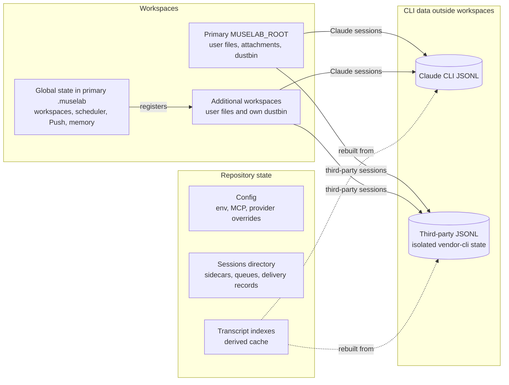
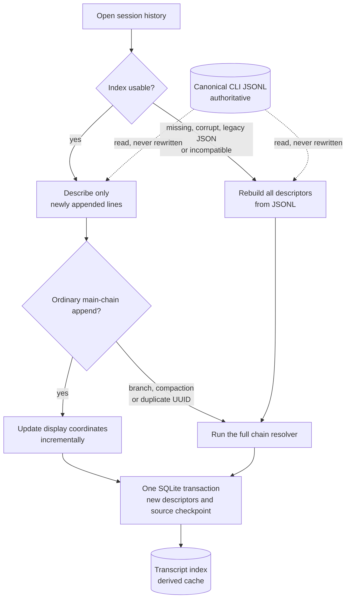
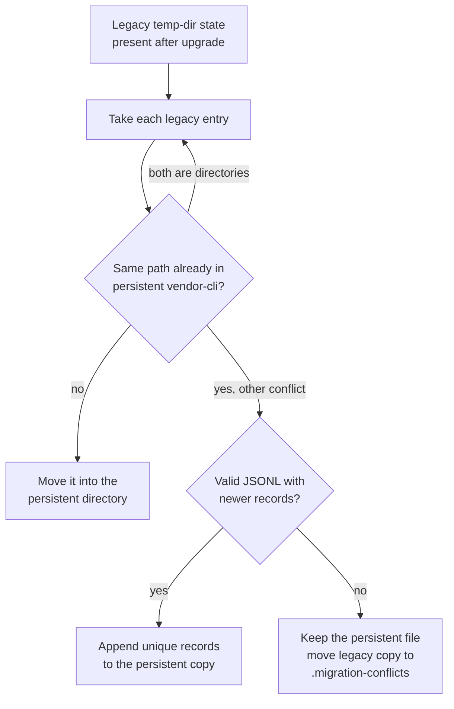

# Data and backup

> [中文](data-and-backup_zh.md)

Core conversations still use CLI JSONL as their source of truth. Enabling
long-term memory adds a SQLite Registry, so a complete migration covers
workspaces, repository state, Claude CLI data, memory data, and optional
browser-local preferences.

How the durable pieces relate:

## Primary workspace

Back up the complete `$MUSELAB_ROOT/` when practical. In addition to user files, it contains:

| Path | Content | Recommendation |
|---|---|---|
| `.muselab/workspaces.json` | Registered workspaces and order | Required; absolute paths may need updating after migration |
| `.muselab/scheduler.json` | Scheduled tasks, history, and unread count | Required when using the scheduler |
| `.muselab/activity.json` | Cross-workspace Activity Center state | Recommended |
| `.muselab/terminal_profiles.json` | Terminal profiles, startup commands, and default selection | Required when using profiles; commands may be sensitive |
| `.muselab/vapid.json` | Web Push VAPID private/public keypair | Recommended together with subscriptions |
| `.muselab/push_subs.json` | Device Push subscriptions | Back up with `vapid.json` to preserve subscriptions |
| `.muselab/imagegen/` | Image-generation job history and durable files | Back up to preserve image history |
| `.muselab/memory/` | Memory config, SQLite Registry, jobs, audit, and disabled Skills | Required when long-term memory is used; config may contain credentials |
| `.muselab-attach/` | Conversation image and PDF originals | Required to preserve attachment previews |
| `.muselab-dustbin/` | Recoverable dustbin for the primary workspace | Back up to preserve recovery |

Deleting `vapid.json` creates a new keypair and invalidates existing browser subscriptions. Restoring `push_subs.json` without its matching VAPID key is not useful.

## Additional workspaces

Back up each registered workspace as needed:

- its user files;
- its own `.muselab-dustbin/`;
- its CLI JSONL outside the workspace: Claude under `~/.claude/projects/`,
  third-party providers under the isolated persistent state root.

Global state remains only under the primary `MUSELAB_ROOT/.muselab/`; it is not copied into every workspace.

## Repository state

| Path | Content |
|---|---|
| `<repo>/.env` | Token, provider keys, and deployment configuration; contains secrets |
| `$MUSELAB_SESSIONS_DIR/` | Session index, sidecars, queues, active-turn sentinels, and derived indexes; defaults to `<repo>/sessions/` |
| `<repo>/mcp.json` | MCP server configuration, possibly with credentials |
| `<repo>/provider_overrides.json` | Built-in provider edits and custom providers |

Source code, `.venv/`, dependency caches, build output, and logs can be restored from the repository or installer and do not need to be treated as user data.

`$MUSELAB_SESSIONS_DIR/<sid>.transcript-index.sqlite3` is a private, derived
byte-offset/descriptor cache, not the conversation source. Appends write only
new descriptors and a small source checkpoint in one SQLite transaction.
Canonical CLI JSONL remains authoritative; missing, corrupt, legacy JSON, or
incompatible indexes are rebuilt without rewriting the transcript. Ordinary
main-chain appends update display coordinates incrementally; branch changes,
compaction, and duplicate UUIDs use the full chain resolver. These caches may
be omitted from backups; keep session sidecars, queues, and canonical JSONL.

Task delivery adds three private locations under `$MUSELAB_SESSIONS_DIR/`:

| Path | Content |
|---|---|
| `delivery/<sid>.json` | Observed task/tool evidence and task-start Git identity |
| `checkpoints/<sid>.json` | Actual SDK checkpoint IDs and observed file fingerprints |
| `checkpoint-recovery/<sid>/` | File contents backed up immediately before an explicit restore |

Back these up to retain the corresponding task and recovery history. Recovery
files can contain sensitive workspace contents. Deleting a session also removes
these records and backups. A backup does not make an old checkpoint safe to
replay after moving a workspace; current identity and file checks still apply.
See [Task delivery and SDK compatibility](task-delivery-sdk.md).

## Claude CLI data

| Path | Content |
|---|---|
| `~/.claude/projects/<cwd-key>/*.jsonl` | Real conversation transcripts for each workspace |
| `~/.claude/.credentials.json` | Claude Pro/Max OAuth login |
| Other files under `~/.claude/` | User-level CLAUDE.md, Skills, permissions, and CLI preferences |
| `${XDG_STATE_HOME:-~/.local/state}/muselab/vendor-cli/` | Isolated third-party-provider transcripts, tasks, and CLI state |

If you only use Claude, the simplest safe approach is to back up all of
`~/.claude/`. If you use third-party providers, also back up the isolated
`vendor-cli/` state directory or those transcripts will not be present in the
`~/.claude/` backup. If credentials are not migrated, run `claude login` again
on the new machine.

On first startup after upgrading, muselab automatically moves the former
`<system-temp>/muselab-vendor-cli-config-<uid>/` state into the persistent
directory. Existing persistent files are never overwritten; any conflicting
legacy files are preserved under `vendor-cli/.migration-conflicts/` for manual
recovery. The one exception is a valid, newer JSONL tail written by the old
process during a rolling restart: unique records are appended safely.

## Ephemeral or unnecessary state

| State | Reason |
|---|---|
| Running and exited terminal sessions | Process-local; only profiles are durable |
| SSE replay spools | OS temporary files used only for same-process reconnect |
| Staged, unsent attachments | Memory-only with a 10-minute TTL |
| SDK clients, rate-limit buckets, and memory caches | Rebuilt after startup |
| Open tabs, layout, and some UI preferences | Browser localStorage; migrate browser data separately if needed |

## Restore procedure

1. Install the same or a newer muselab version on the new machine.
2. Stop the service.
3. Restore the primary workspace, required additional workspaces, repository state, `~/.claude/`, and isolated transcripts when third-party providers are used.
4. Check `MUSELAB_ROOT` and `MUSELAB_SESSIONS_DIR` in `.env`, then update stale workspace paths through the workspace picker.
5. Verify ownership and permissions, especially for `.env`, Claude credentials, VAPID keys, and terminal profiles.
6. Start the service and test workspaces, session history, attachments, scheduled tasks, terminal profiles, image history, and Push.
7. Run `bash scripts/doctor.sh` for a basic health check.

Backups contain tokens, API keys, OAuth credentials, and Push private keys. Terminal profiles can also contain user-written commands. Encrypt them and never commit them to Git or place them on a shared drive.

## Persistent Docker configuration layout

The `/app/sessions` mount also contains `config/.env`, `config/mcp.json`, `config/provider_overrides.json` and `state/muselab/vendor-cli/`. Back up the entire mount as well as the workspace and Claude state mounts. Configuration is not rebuildable cache. Saved UI values override matching bootstrap env-file values; back up and explicitly edit the persistent file when resetting them. Before upgrading an older image, export its unmounted state using the [migration guide](docker-state-migration.md).
