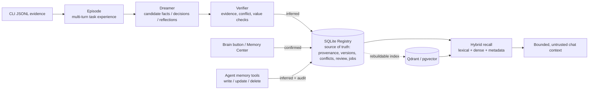
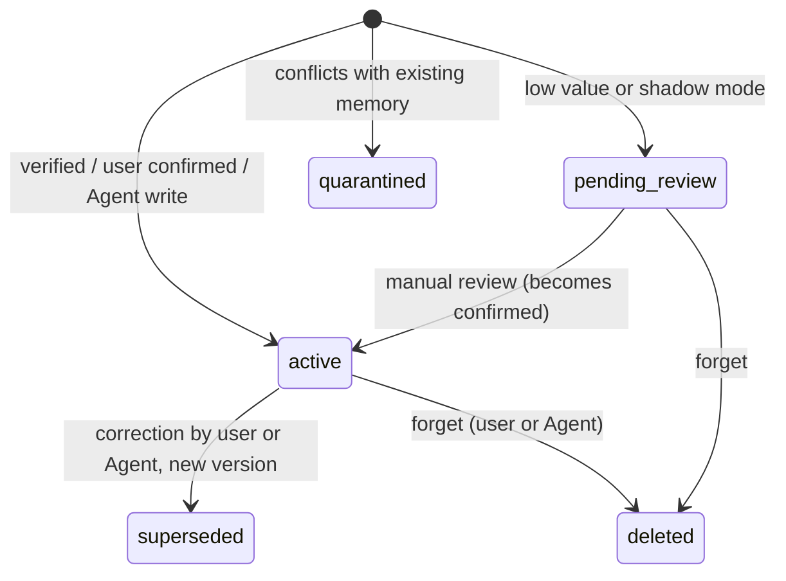
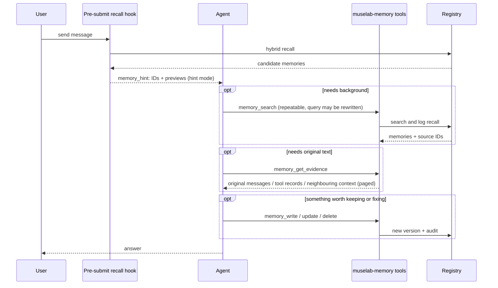
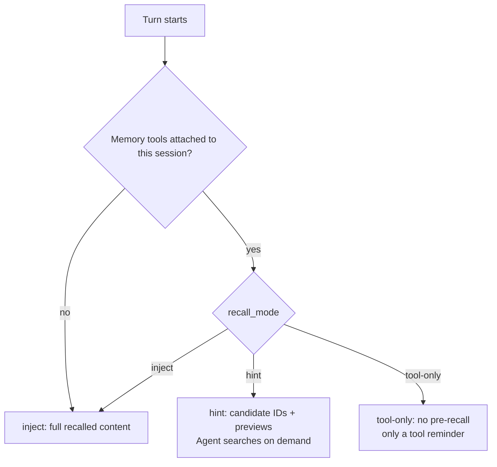
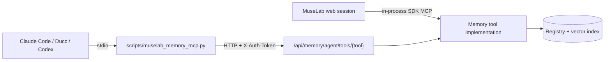
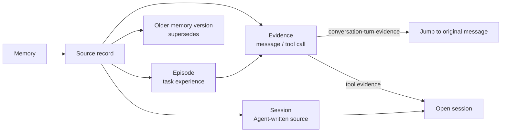

# Long-term memory

> [中文](memory_zh.md)

MuseLab's optional long-term memory stores durable business context,
preferences, decisions, and agent experience. It is disabled by default and is
not a repository-wide file RAG feature.

## Architecture

The canonical SQLite Registry retains evidence, Episodes, provenance,
versions, conflicts, review state, jobs, and audit events. Qdrant or pgvector
is only a rebuildable dense index. Retrieval fuses SQLite FTS, dense similarity,
metadata, authority, and confidence, with an optional reranker.



Memories are written through three entry points — background dreaming, user confirmation in the UI, and Agent tool calls — all landing in the same Registry.

Each user has one logical memory pool. Workspaces, domains, topics, and entities are soft metadata, not isolated memory stores. Rebuild the retrieval index from the Registry after changing the embedding model or vector database.

## Setup

Configure Memory under Settings with:

1. a configured chat model for Dreamer and Verifier;
2. an OpenAI-compatible embedding endpoint;
3. Qdrant or PostgreSQL + pgvector;
4. an optional reranker.

Saving an enabled configuration through the UI probes the required capabilities by default; a failed probe prevents activation. `off` has no chat overhead, `shadow` forms reviewable candidates without recall, and `active` enables bounded hybrid recall. The UI exposes one recall timeout in seconds: `0` (the default for new configurations) waits without a recall deadline; a positive value bounds the complete recall pipeline. Existing configurations retain their saved value under `retrieval.soft_timeout_ms`. Recent context, dense and lexical search, hydration, and enabled reranking share that budget, without shorter internal timers. Recall runs before SDK query submission; its one-shot result is injected through `UserPromptSubmit.additionalContext`, so the SDK hook timer cannot silently discard a slow recall. Stop still cancels the wait. Logs record stage starts, durations, result counts, timeout and cancellation states without query or memory text. Retrieval or reranking failures and timeouts preserve available results where possible, or continue the reply without injecting memory. Dreamer, Verifier, indexing, and Skill learning run in the background.

## Dreaming and hybrid recall

Dreaming consolidates task experience. When a session reaches the configured turn or idle threshold, its Episode enters the background consolidation queue. “Dream now” also queues a job. Dreamer extracts candidate facts, decisions, and reflections; Verifier checks evidence, conflicts, and future value. Automatic consolidation requires memory to be enabled and the Worker to be running. Generated memories are inferred records, not user-confirmed facts.

In active mode, hybrid recall combines keyword and semantic-vector retrieval, then ranks results using authority, confidence, and usage feedback, with an optional reranker. It searches available memories in the Registry, not the entire workspace. Memory files inside a project are ordinary project materials, separate from this cross-session memory system.

## Memory management

The Memory Center supports search, sorting, pagination, confirmation, correction, and deletion. It exposes memories, sources, Episodes, reflections, conflicts,
jobs, recall traces, and Skill candidates. The brain button beside a chat
message is a deterministic confirmed-memory action; natural-language
"remember/correct/forget" classification is not required. Corrections retain a
`supersedes` edge and forgetting also removes the vector entry.



Workers can create Skill drafts only. A draft remains in SQLite and cannot be
discovered by the SDK. An authenticated, explicit approval installs it under
`~/.claude/skills/muselab-generated-<name>/SKILL.md`; disabling moves it out of
the discoverable directory while preserving its audit trail.

## Agent-autonomous memory

In active mode every chat session gets the in-process MCP server `muselab-memory`, so the Agent can call:

| Tool | Purpose |
| --- | --- |
| `memory_search` | Hybrid keyword + semantic search with an optional kind filter; rewrite the query and retry on a miss |
| `memory_get_evidence` | Trace a memory, evidence (`ev_…`) or Episode (`ep_…`) back to the original user/assistant messages, tool records and neighbouring context; long content is paged |
| `memory_write` | Save one durable fact, preference, decision or lesson; exact duplicates are ignored and similar memories are returned for merging |
| `memory_update` | Correct or rewrite any memory (including user-confirmed ones) as a new `supersedes` version; the old version stays in history |
| `memory_delete` | Forget a wrong, obsolete or duplicate memory and remove its vector |

The Agent may modify any memory without confirmation. Every write, update and delete is audited (`agent_write` / `agent_update` / `agent_delete`); new versions are `inferred` and carry the session source and the edit reason, so the memory center can inspect and revert them. Tool output is always marked as untrusted background data.

A typical turn in which the Agent uses memory:



Per-turn recall is controlled by `retrieval.recall_mode`:

- `hint` (default): inject only candidate IDs and ~160-character previews, and nudge the Agent to search and trace on demand;
- `inject`: inject the full recalled facts (previous behaviour);
- `tool-only`: no pre-recall, only a reminder that memory tools exist.

`hint` and `tool-only` apply only when the session's client actually has the memory tools attached; otherwise recall falls back to `inject`, so no recalled content is lost.



Other Agent CLIs (Claude Code, Ducc, …) can share the same memory through the stdio bridge, which forwards calls to the running MuseLab via the token-protected `/api/memory/agent/tools/<tool>`:



```bash
claude mcp add muselab-memory -e MUSELAB_URL=http://127.0.0.1:8765 \
  -e MUSELAB_TOKEN=<token> -e MUSELAB_MEMORY_CLIENT=claude-code -- \
  python3 /path/to/muselab/scripts/muselab_memory_mcp.py
```

## Source evidence tracebacks

Memory sources can link to Episodes, conversation messages, and tool records. Open a source to return to its session. Conversation-turn evidence records its message ID, so it jumps straight to the original message, and jumpable sources are listed first. Tool evidence and Agent-written session sources locate the session. Missing records or entries without sources may not support a traceback.



“Copy evidence” copies session evidence locators, including session and workspace information and original record paths. It does not copy the full conversation or recreate the execution environment. Locators may contain private paths and identifiers; inspect and redact them before sharing publicly.

## Reflection and value checks

Cross-Episode reflection requires the configured number of independent
Episodes. Independence is computed from normalized evidence content, so forked
or copied transcripts do not count as separate support. Every candidate names
its source Episodes. The white-box value score combines Verifier prediction,
independent-Episode count, historical recall-query fit, and novelty. Verifier rejects unsupported or conflicting candidates, which may leave no reviewable memory entry. Candidates that pass verification but have low value, or are produced in shadow mode, remain `pending_review`. Failed turns form separate failure Episodes, while
cancelled turns remain evidence-only and cannot reach Dreamer or Skill Learner.
Orphaned running jobs are requeued when the worker next starts.

## Data, migration, and recovery

Data lives in `$MUSELAB_ROOT/.muselab/memory/` by default and can be relocated
with `MUSELAB_MEMORY_DIR`. Back up the whole directory after stopping the
service, or include SQLite WAL/SHM files. The API exposes a neutral JSON export,
a rebuild operation, and a legacy Mem0 import whose provenance-poor facts enter
as low-confidence `pending_review` items.

Third-party generation uses its configured API key. For Claude authenticated
through `claude login`, background generation creates a fresh one-turn SDK
query with `tools=[]`, no MCP, and no Skills. It never borrows a live chat
client or receives Agent tool authority.

## Deployment verification

On a deployment/test machine, run:

```bash
uv sync
.venv/bin/pytest -q \
  tests/test_memory_store.py tests/test_memory_api.py \
  tests/test_memory_engine.py tests/test_memory_providers.py \
  tests/test_memory_client.py tests/test_frontend_lint.py
node --check frontend/app.js
```

Probe and begin in `shadow` mode, verify independent Episode provenance and
review state, then switch to `active`. Confirm that recall traces are visible,
provider outages remain fail-soft, and generated Skills remain inert until an
explicit authenticated approval.

### Targeted historical summary repair

Dreamer JSON parsing and field validation share at most two generation calls.
Empty titles/summaries or invalid fields fail explicitly rather than recording an
empty success. After candidate verification, the summary, new facts, sources and
index jobs commit together. A valid summary with no reusable facts is allowed.

`scripts/repair_memory_once.py` defaults to a read-only dry-run over an explicit
manifest; it does not retry every failed job:

```json
{"owner_id":"your-owner","items":[{"episode_id":"ep_...","job_ids":["job_..."],"mode":"summary-only"}]}
```

Use `summary-only` to fill the summary without changing existing facts or nonempty
episode metadata. `full` requires complete evidence and no existing generated
products; partial products, active jobs and ownership conflicts require review.
All actions require `--db` and `--manifest`:

- `--action generate --output prepared.json` uses the current memory configuration
  and a read-only Registry to freeze verified results. Set the configuration path
  explicitly: `--db` does not select a different configuration.
- `--action apply --prepared prepared.json` performs no model calls. Each item
  checks its source fingerprint and commits atomically with a durable replay
  receipt. Old failed jobs remain intact; conflicts stop application.

Verify against a consistent private snapshot first. The target Registry must
already have this version's schema migrations; apply does not run global
migrations. Prepared files contain private memory and must not enter Git or public
attachments. An enqueued index job is not proof of indexing: wait for the worker
and verify actual recall.

For an existing Registry that already has the baseline repair migrations, add the
repair covering indexes separately, without invoking the normal constructor:

```python
from pathlib import Path
from backend.memory_store import MemoryStore
MemoryStore.migrate_existing_repair_indexes(Path("/absolute/path/to/registry.sqlite3"),
                                           timeout_seconds=30)
```

This existing-file-only, marker-controlled migration adds only
`artifacts(source_episode_ids_json,id)` and `memories(owner_id,kind,content)` in one
transaction. It does not rebuild FTS or backfill recall statistics. Rehearse the
same call on a private snapshot first; missing baseline schema is refused. A SQL
interruption or expiry before commit rolls back indexes and marker together;
retry after resolving contention. Apply/replay require both indexes and the marker
but never create them. The per-item apply deadline remains 0.5 seconds. SQLite
progress callbacks cannot preempt blocked disk I/O or commit/fsync, so neither the
30-second migration budget nor offline timings guarantee cold-storage wall time.

### Recall latency and diagnostics

Recall uses read-only connections to the WAL registry. Lexical retrieval has a
separate SQLite actor and cancellation state from recent-evidence reads and
hydration, so a slow lexical query cannot queue healthy dense hydration behind it.
Background consolidation, job bookkeeping, and recall telemetry use the write
actor. A recall read does not initialize or migrate the schema.

The timeout starts at recall entry and covers recent evidence, dense and
lexical retrieval, hydration, and optional reranking. Zero disables the recall
deadline; positive values apply to all stages together. There is no reserved
sub-budget or independent facade timer. Each channel hydrates its hits as soon
as it finishes. Reranking failure preserves hydrated results and reports partial
success. Cancelling a wait also interrupts its executing SQLite query.

Recall finishes before SDK query submission, including queued follow-up
messages. The hook consumes each result once for its exact prompt, retaining
the canonical user message unchanged. If the active turn finishes while a
follow-up is recalling, that message stays queued for the next turn. Its
preparation cannot replace the active reply's already-injected recall receipt.

Safe performance events `memory.recall_start`, `memory.recall_stage_start`,
`memory.recall_stage`, `memory.recall_wait`, `memory.recall_finish`, and
`memory.recall_hook_finish` report stage outcomes, elapsed time, counts,
and whether context was injected, without query or memory text. Waiting emits
a progress record every five seconds; cancellation has its own status. The recall ID
continues into `done.memory_recall`; the footer counts facts actually injected
after sanitization and context limits. Persistent receipts keep IDs and stage
diagnostics without duplicating memory contents. These diagnostics concern
recall; generation-provider failures during consolidation remain separate.
