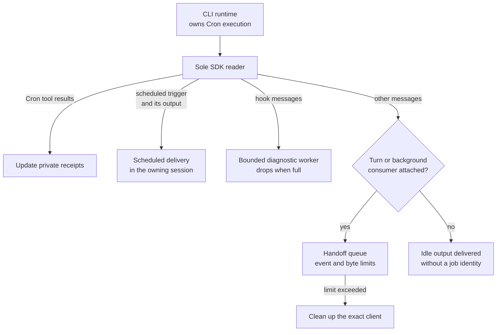
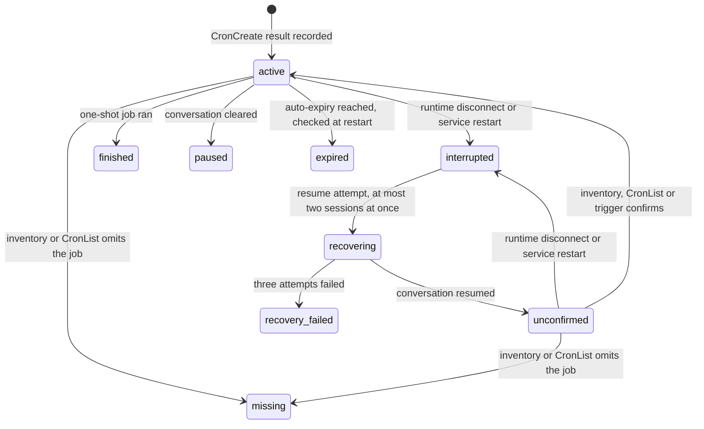
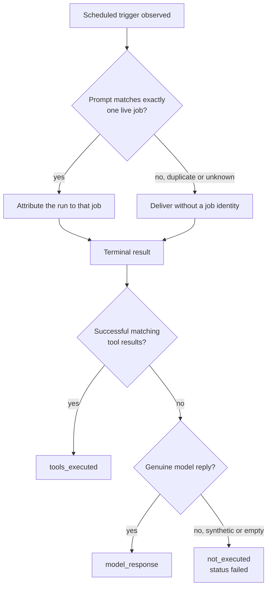

# Native chat Cron reliability

`CronCreate`, `CronList`, and `CronDelete` remain CLI-owned tools. MuseLab consumes
idle hook diagnostics and autonomous scheduled output through the existing sole
SDK reader. Hook diagnostic backpressure cannot fill the orphan queue. Genuine
undelivered messages retain the existing event/byte limits and exact-client cleanup.



MuseLab records successful native tool results in private, bounded, atomic
`native-cron/<session-id>.json` receipts beneath its sessions directory. These are
recovery records, not another scheduler. A requested `durable` flag is only shown
as confirmed persistence when the native tool result actually confirms it.

On an unexpected runtime disconnect or service restart, MuseLab attempts to
resume the original conversation after cleanup, with its stored model and
permission mode. There are three bounded attempts and at most two recoveries
in flight. No task is recreated and no prompt is automatically replayed. A
connected conversation stays **unconfirmed** until a native task inventory,
`CronList`, or an identifiable scheduled trigger confirms the job. Runtimes that
omit inventory data cannot be treated as having an empty inventory.

Receipt states and the transitions MuseLab applies to them:



Interrupted, missing, and expired tasks remain inspectable. Explicit conversation
clear pauses their receipts; session deletion prevents late writes from recreating
them. Up to 50 runnable or uncertain jobs and 50 recent terminal receipts are
retained per session. Private receipts include the same bounded prompt preview
as the authenticated task inspector; operational logs contain no prompt/output.

A synthetic `No response requested.` or an otherwise empty terminal result is
**failed / not_executed**. A genuine model reply is recorded separately from
successful matching tool results. Tool success does not prove a business-specific
inspection passed. Duplicate prompts are ambiguous and are not attributed to an
arbitrary job. Output with an omitted trigger is still delivered, with no invented
job identity.



## Limits and verification

Native CLI versions and compatible runtimes differ in schedule persistence and
resume support. A MuseLab receipt cannot make an unsupported native schedule
durable. A missing task needs explicit recreation in the chat; critical operations
must not interpret a reconnected session as proof that the schedule is running.

Regression coverage:

```sh
uv run pytest tests/test_native_cron_reliability.py tests/test_chat_stream.py tests/test_runtime_buffer.py
RUN_E2E=1 uv run pytest tests/e2e/test_native_cron_reliability.py
```

The regressions use synthetic SDK messages and a real browser against a temporary
backend. They verify application ownership, recovery, visibility and execution
evidence; they do not certify unattended execution by every external model or CLI.
