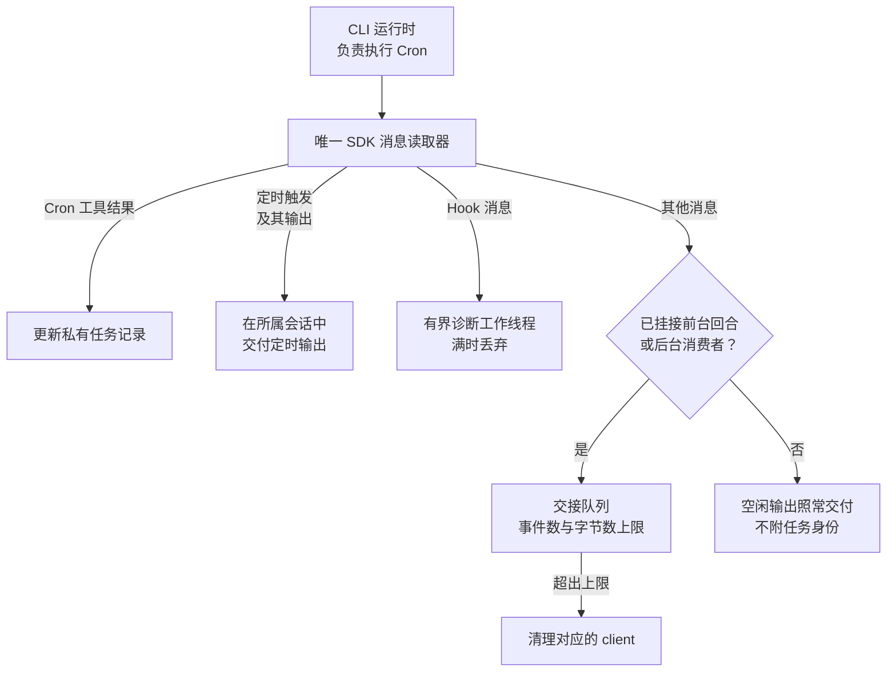
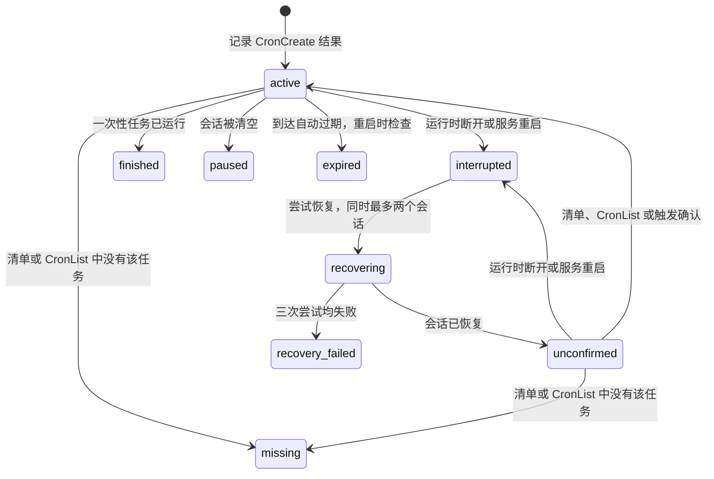
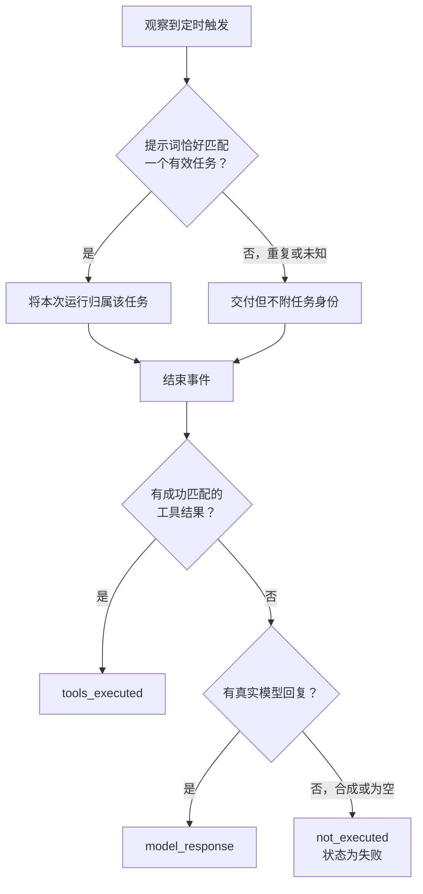

# 聊天原生 Cron 的可靠性

`CronCreate`、`CronList`、`CronDelete` 仍由 CLI 执行。MuseLab 通过现有的唯一 SDK
消息读取器消费空闲期 Hook 诊断和定时任务输出。诊断写入拥塞不会挤满孤儿消息队列；
真正未交付的消息继续受事件数和字节数限制，超限时清理对应运行时。



MuseLab 根据原生工具的成功返回，在会话存储目录的 `native-cron/<session-id>.json`
中原子保存私有、有限大小的任务记录。记录用于恢复和展示，不构成另一套调度器。
只有原生工具返回确实确认持久化，界面才显示持久化成功；传入 `durable` 不等于已生效。

运行时意外断开或服务重启后，MuseLab 等待旧进程清理，再按原会话保存的模型和权限恢复。
自动恢复最多尝试三次，同时最多恢复两个会话，不重建任务、不自动重放提示词。
连接成功后仍显示“任务待确认”，直到原生任务清单、`CronList` 或可识别的真实触发确认任务。
旧版运行时未提供清单字段时，不会将其解释成空清单。

任务记录的状态及 MuseLab 施加的转换：



中断、缺失和到期任务仍可查看。显式清空会话会暂停任务记录；删除会话后，延迟写入不得
重建记录。每个会话最多保留 50 条有效或待确认记录，以及 50 条最近的终态记录。
私有记录包含与鉴权后任务详情相同的有限长度提示词预览；运行日志不包含提示词和输出正文。

合成的 `No response requested.` 或没有有效输出的结束事件，标记为
**失败／未执行**。真实模型回复与成功匹配的工具结果分别记录；工具返回成功不等于业务巡检通过。
多个任务提示词相同时，不随意归属到某个任务。运行时省略触发消息时仍交付输出，不伪造任务身份。



## 限制与验证

不同原生 CLI 版本及兼容运行时的持久化、会话恢复能力可能不同。
MuseLab 的任务记录不能让不支持持久化的原生任务变得持久化。
显示原生任务缺失时，需要在聊天中明确重建；不能把聊天重连成功当作计划持续运行的证据。

回归验证：

```sh
uv run pytest tests/test_native_cron_reliability.py tests/test_chat_stream.py tests/test_runtime_buffer.py
RUN_E2E=1 uv run pytest tests/e2e/test_native_cron_reliability.py
```

测试使用合成 SDK 消息，以及连接临时后端的真实浏览器，验证应用的消息归属、恢复、状态展示
和执行证据；这些测试不能认证每种外部模型或 CLI 的无人值守执行能力。
