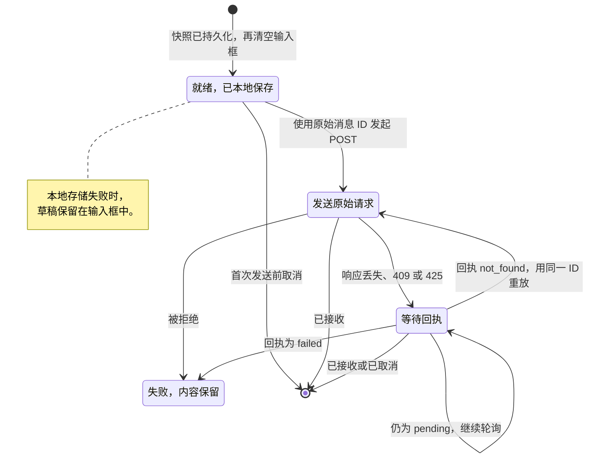
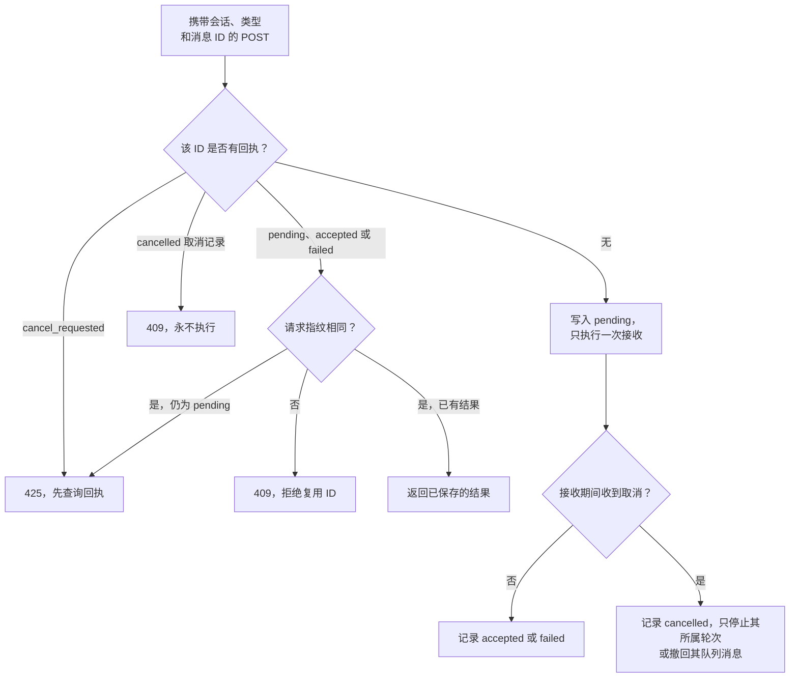
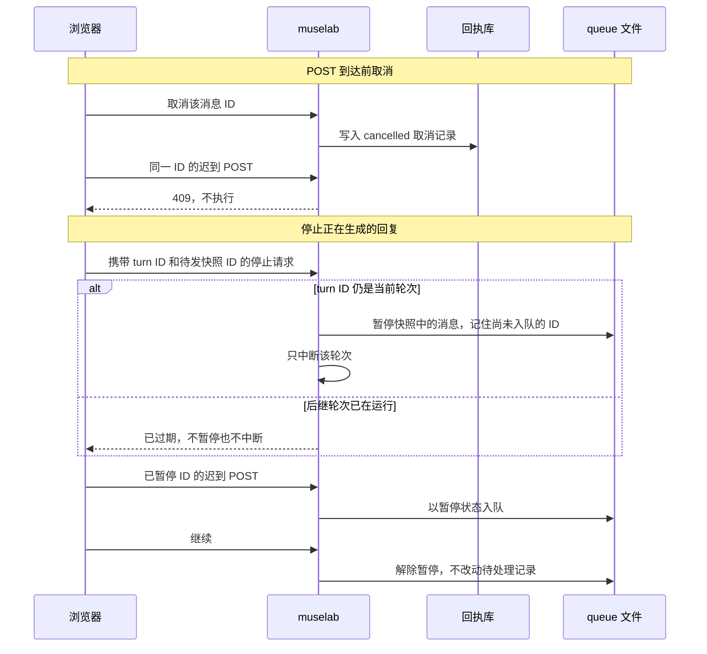

# 非阻塞消息投递

输入框接受新消息，不依赖 HTTP 回执、正在执行的轮次或尚未完成的停止请求。
在收到明确回执之前，本地提交不会被展示为服务端已接收。

## 行为契约

- 当前提交尚未确定结果时，后续输入先保存到持久化的浏览器发件箱，再清空输入框。
  如果本地存储失败，草稿保持不变。
- 恢复投递使用原始会话、消息 ID 和请求载荷。只有服务端明确表示回执不存在时，
  才能重试同一个幂等请求；尚未完成的提交预留不允许使用新 ID 再次执行。
- 送达状态未知只影响对应消息，不能锁住输入框。
  回执恢复期间，已经显示的消息气泡保持原位。
- 取消只针对一个提交身份。取消记录可以拦住迟到的 POST 请求；
  如果请求已经被接收，则只停止该请求所属的不可变轮次。
- 停止当前回复时，同时暂停点击前的待发消息快照。暂停状态在重启后保留，
  但不阻塞之后手动发送的新消息，也不占用可执行队列的容量。
  继续待发消息只解除显式暂停，不会重放失败或执行状态未知的记录。
- 迟到的停止请求不能暂停或中断后继轮次。
- 后台运行会话切换时，浏览器发件箱记录保留原来的回执归属。

单条浏览器发件箱记录的生命周期：

服务端回执决定携带已知消息 ID 的 POST 能做什么：

取消与停止只作用于一个身份，绝不影响后继轮次：

## 回归检查

tests/test_nonblocking_delivery.py 覆盖显式暂停、重启、迟到请求、
幂等取消及过期停止请求的轮次归属。
tests/e2e/test_nonblocking_delivery.py 覆盖连续发送、回执丢失、本地取消、
停止与发送重叠、持久化恢复及存储失败。
现有队列、提交、多标签页和交互反馈测试仍是必需的回归检查。
tests/test_docs.py 检查文档一致性，包括必需的英文和中文文档配对。

传输回执恢复是实现细节，不是需要用户确认的审批步骤。

## 慢存储诊断

记忆配置检查在事件循环之外执行，包括缓存命中时的文件元数据检查。
同一会话的并发状态请求共享一次只读磁盘快照，再在事件循环中合并实时广播状态。
任务卡片写入仍须完成，所属操作才会越过持久化边界。

成本面板合并并发刷新，统计快照最多复用两秒。之后通过各文件的版本检查缓存失效，
复用未变化转录文件的统计结果。外部写入和侧车文件中的费用修改在下次刷新时纳入。

`memory.storage_read` 区分锁等待、连接、取数及解码、关闭连接的耗时。
`chat.task_overlay_persist` 区分运行会话链查询和持久化；
`chat.context_preflight` 同时记录成功、失败及耗时。存储执行时间长，不能单独证明 SQL 慢。
生成结果格式诊断只记录长度和解析位置，不记录响应正文。召回期限和原生压缩判断保持原有语义。

`tests/test_log_bottlenecks.py` 覆盖慢存储、共享读取、取消、所有者隔离、增量统计和异常 JSON。
