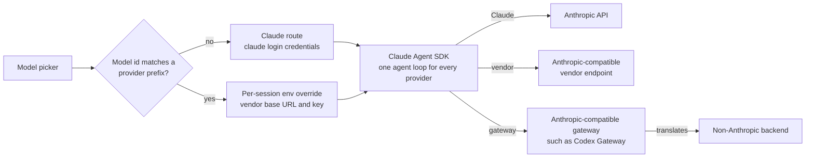
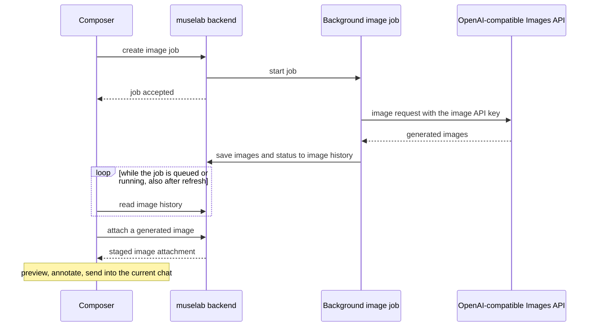

# Providers

> [简体中文](providers_zh.md)

muselab uses the **Claude Agent SDK** as the single chat backend. For
non-Claude models, a per-session env override routes the SDK at the
vendor's Anthropic-compatible endpoint. **Every provider gets the full
agent loop** — not just chat. muselab itself never implements OpenAI-native
protocols; if a backend is not Anthropic-compatible, put a gateway in front
of it.

The shape of that routing (environment details are in [Model routing](routing.md)):

| Provider | How to enable | Tool use | Where to get the key |
|---|---|---|---|
| **Anthropic Claude** | `claude login` once | ✅ | Reuses Pro / Max OAuth; no API key |
| **DeepSeek** | `DEEPSEEK_API_KEY` in Settings | ✅ | platform.deepseek.com |
| **Zhipu GLM** | `ZHIPUAI_API_KEY` | ✅ | bigmodel.cn |
| **MiniMax** (domestic / international) | `MINIMAX_API_KEY` / `MINIMAX_INTL_API_KEY` | ✅ | minimaxi.com / minimax.io |
| **Kimi** | `MOONSHOT_API_KEY` | ✅ | platform.moonshot.cn |
| **Qwen** (domestic / international) | `DASHSCOPE_API_KEY` | ✅ | dashscope.console.aliyun.com |
| **Xiaomi MiMo** | `XIAOMI_MIMO_API_KEY` | ✅ | platform.xiaomimimo.com |
| **Baidu Qianfan** | `QIANFAN_API_KEY` | ✅ | console.bce.baidu.com/qianfan; the Anthropic-compatible path needs an IAM access token |
| **Codex Gateway** (local sidecar) | `CODEX_GATEWAY_API_KEY` | ✅* | A user-run Anthropic-compatible gateway at `127.0.0.1`; see [codex-gateway.md](codex-gateway.md) |
| **OpenAI** (Anthropic-compatible route) | The current built-in reuses `ZHIPUAI_API_KEY` and its compatible endpoint | ✅* | Supplied by the operator; muselab does not call the native OpenAI Chat/Responses API |
| **Custom provider** | Add endpoint, prefix, models, and key in Settings → Providers | endpoint-dependent | Any Anthropic Messages-compatible service |

\* Tool use depends on the gateway translating Anthropic `tool_use` / `tool_result` correctly.

Exact model IDs and availability come from the UI dropdown. It reflects the
effective catalog (built-in defaults, overrides, and custom entries) and
evolves faster than this page, so this table deliberately avoids model counts.

## Image generation

The composer image button is separate from chat providers. It calls an
OpenAI-compatible Images API configured with `OPENAI_IMAGE_API_KEY` (or the
`OPENAI_API_KEY` fallback) and `OPENAI_IMAGE_BASE_URL`. The endpoint may be
OpenAI itself or a narrow self-hosted adapter such as
[codex-image-api](https://github.com/hesorchen/codex-image-api).

muselab does not launch Codex or hold Codex OAuth state. Keeping image execution
behind a dedicated API makes the credential and process boundary independent of
the web application. Generated images are staged as ordinary muselab image
attachments, so they can be previewed, annotated, and sent into the current
chat. Requests run as background jobs and remain available in the image history
drawer after a page refresh.

## Switching model mid-conversation

If the current session already has messages, the dropdown opens a confirm
modal and creates an empty session with the new model — the original is kept
in history and its transcript is not copied. Empty sessions switch in place.
Starting from a blank transcript avoids cross-vendor thinking-signature drift,
which causes silent breakage when one provider's signed thinking blocks are
sent back to a different provider.

Each assistant message stores its own `model` field, so badges remain
accurate even after a page reload that re-renders the whole transcript.

## Adding a new provider

Add one in **Settings → Providers** — endpoint, prefix, model list, and key;
it takes effect immediately, no restart. Providers can also be shipped as
built-in defaults via a `CATALOG` entry in `backend/endpoints.py` (the
contributor path). See [add-provider.md](add-provider.md) for both paths and
the rationale behind the per-session `CLAUDE_CONFIG_DIR` isolation.
