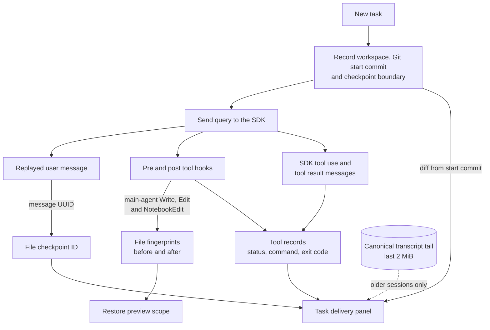
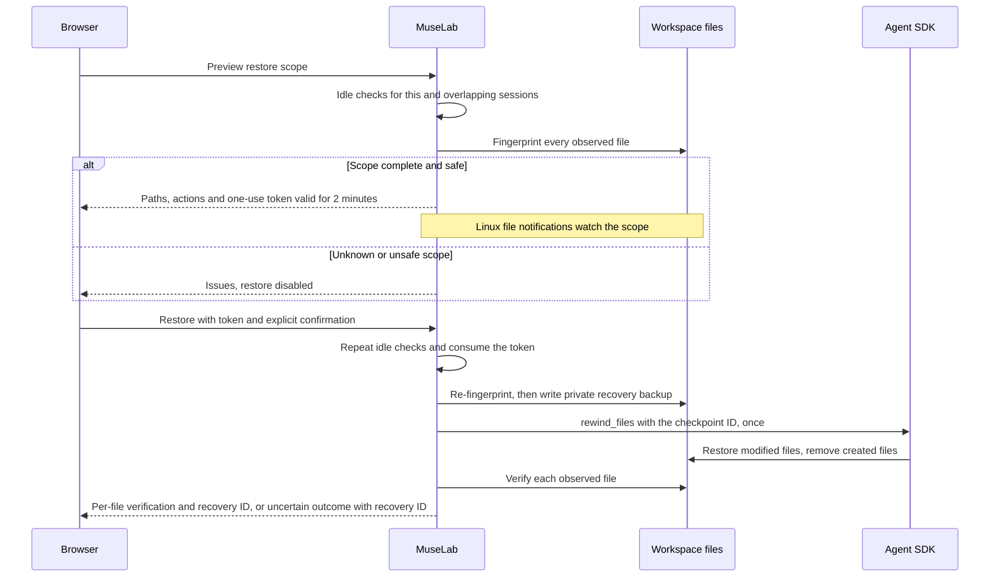

# Task delivery and SDK compatibility

[中文](task-delivery-sdk_zh.md)

Open **More tools → Task delivery and environment** in the chat toolbar (package icon).
Choose a task to inspect its observed files, executed commands, message evidence,
Git changes and file checkpoints. The panel is useful in non-Git workspaces too.

## Reading the evidence

- File artifacts come from completed Write, Edit or NotebookEdit tool records.
  **Evidence** opens the corresponding transcript message; the filename opens
  the file in its owning session workspace.
- **Tool completed** means the SDK reported successful tool execution. It does
  not establish passing tests. A Bash result without an integer structured
  exit code is shown as **exit code unavailable**. Assistant prose and stdout
  such as “all tests passed” never create a passing check.
- New tasks record the workspace and starting Git commit before the query.
  If the workspace was already dirty, the diff explicitly includes those
  earlier changes. Other writers can contribute changes; this is not exclusive
  agent attribution. Git diff excludes untracked files.
- Old sessions can recover recent tool evidence from the canonical transcript
  tail. They have no retroactive Git baseline, checkpoint or invented terminal
  status. At most 30 tasks and 300 tools per task are presented; the historical
  read is capped at 2 MiB. Inspect the transcript for earlier evidence.

Where each piece of evidence comes from:

The environment panel shows the registered workspace, branch/worktree, dirty
state, backend and host. The service origin is the authenticated browser origin.
Chat and preview headers have no persistent environment labels. Inspect session
environment details in this panel; a terminal may use a different workspace.
Opening or refreshing the delivery panel refreshes identity.
Git probes are read-only, have a two-second timeout per command and bounded
output, and disable filesystem-monitor commands from Git configuration.

## Reviewing a file restore

1. Finish or stop the task, clear its pending queue and remove native scheduled
   tasks. Other MuseLab sessions using the same or an overlapping workspace must
   have no active turns, background writers or native scheduled tasks.
2. Select **Preview restore scope**. Review every observed path and action.
   Modified files restore their contents; files created since that checkpoint
   are removed. Any unknown or unsafe scope disables restoration.
3. Stop other editors and processes from writing these files, then explicitly
   confirm the scope. The confirmation expires after two minutes.
4. MuseLab checks the files again, saves a private recovery backup, invokes the
   public SDK operation once and verifies each observed file afterward. A failed
   or uncertain result is shown with a recovery ID; do not infer success from
   the SDK control response alone.

The current Python SDK has **no public dry-run argument and returns no file
list**. The preview is MuseLab's observation of main-agent Write, Edit and
NotebookEdit hooks, not a fabricated SDK dry-run. Bash changes and general
subagent edits are excluded; conversation history is preserved. You cannot
select an arbitrary subset because the public rewind operation has no path
filter. A changed file, symlink, hardlink, moved directory, incomplete hook
sequence, runtime replacement or another workspace prevents restore. Linux
file notifications detect edits made and undone while the preview is open.

The SDK provides no atomic compare-and-swap with arbitrary external writers.
Stopping those writers remains necessary even after the final fingerprint
check. Single-file observations are limited to 4 MiB. A session is limited to
2,000 observed file operations; one restore covers at most 200 files and 16 MiB; an exceeded limit disables restoration rather
than presenting an incomplete scope. Recovery backups are private local state
under the configured sessions directory, keyed by session and recovery ID.
They can contain file contents and must never be published. Deleting a session also removes its delivery records, checkpoint observations and recovery backups. These limits do
not prevent ordinary agent work.

## Verified compatibility matrix

| Capability | Public SDK contract | MuseLab behavior | Verification |
| --- | --- | --- | --- |
| File checkpointing | `enable_file_checkpointing=True`, replay user messages, `UserMessage.uuid` | Persist the actual checkpoint ID and observed scope | SDK 0.2.149 and 0.2.152 |
| File rewind | `await client.rewind_files(user_message_id)` returns `None` | Idle-session guard, preview, explicit confirmation, one-use token, backup and verification | Real bundled CLI Read → Write → rewind on a temporary file; localhost model fixture only |
| Rewind dry-run / file list | No public Python parameter or returned list in the checked releases | Clearly labeled local observation; unknown scope disables restore | Actual installed signatures and source checked |
| Tool outcome | `ToolResultBlock.is_error`; Bash structured results may omit exit code | Show tool status and unknown exit code independently of test claims | SDK-shaped messages and authenticated API tests |
| Hook and subagent events | `include_hook_events`, `forward_subagent_text` | Existing hook timelines and subagent presentation remain available | Existing SDK and chat regressions |
| Live steering | MuseLab's `MuseLabSDKClient` adapter; not a public upstream `query_steering` interface | Existing command lifecycle and cancellation UI | Separate adapter boundary; not claimed as upstream SDK API |
| DUCC runtime | Separate runtime backend | Task/environment evidence can still be displayed; this integration does not enable Claude SDK file rewind for DUCC | Backend identity is reported explicitly |

The isolated checkpoint protocol probe is `scripts/probe-checkpoint-offline.py`.
It uses temporary files, temporary CLI configuration, a loopback fake provider
and no real model. Run it with the target environment's Python interpreter.
The default exposes only Read/Write; `--all-tools` also captures the actual
bundled CLI's default init tool names for compatibility checks. SDK 0.2.152 with
bundled CLI 2.1.259 passed the same real write-and-restore probe on 2026-09-06.
This is checkpoint/protocol evidence, not a provider-wide model regression.

Official references: [File checkpointing](https://code.claude.com/docs/en/agent-sdk/file-checkpointing),
[Python SDK](https://code.claude.com/docs/en/agent-sdk/python),
[SDK 0.2.152 release](https://github.com/anthropics/claude-agent-sdk-python/releases/tag/v0.2.152).
