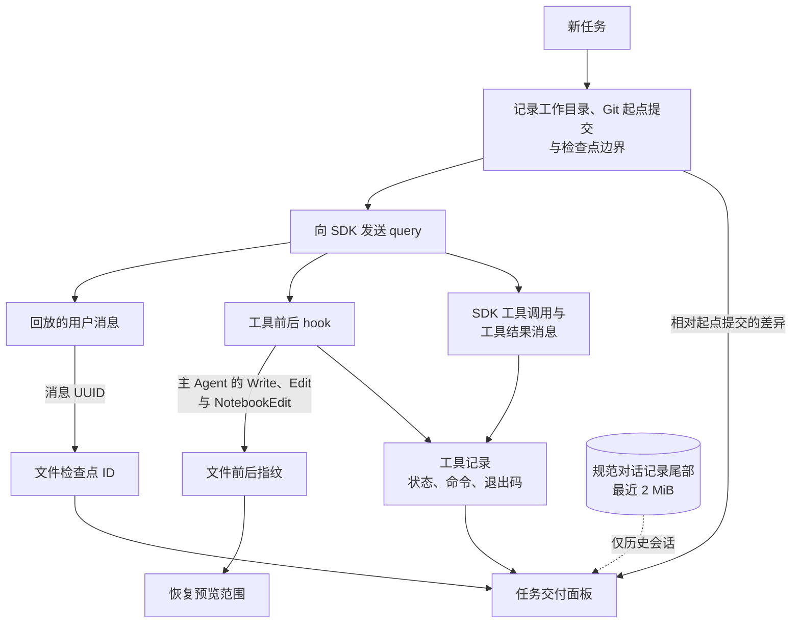
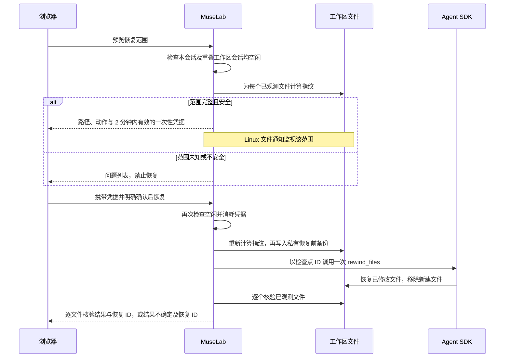

# 任务交付与 SDK 兼容性

[English](task-delivery-sdk.md)

点击聊天工具栏「更多工具 → 任务交付与环境」（包裹图标），选择任务，查看实际记录的文件、执行命令、消息证据、Git 差异和文件检查点。非 Git 工作目录也能使用文件与命令证据。

## 如何阅读证据

- 文件产物来自已完成的 Write、Edit 或 NotebookEdit 工具记录。「消息证据」定位对应的对话消息；文件名在所属会话工作目录中打开文件。
- 「工具已完成」只表示 SDK 报告工具调用成功，不表示测试通过。Bash 没有返回整数型结构化退出码时，显示「退出码未知」。助手文字和 stdout 中的「全部通过」不会生成测试通过结论。
- 新任务在发送 query 前记录工作目录与 Git 起点提交。如果起点已有未提交修改，差异会明确说明包含既有修改。其他操作也可能修改同一工作区，不能全部归因于 Agent。Git 差异不包含未跟踪文件。
- 历史会话可以从最近的规范对话记录恢复工具证据，但不能补造 Git 起点、文件检查点或任务结束状态。最多展示 30 个任务、每个任务 300 个工具；历史读取上限为最近 2 MiB。更早证据请查看对话。

各类证据的来源：

环境面板显示已登记的工作目录、分支／worktree、dirty 状态、后端和主机；服务来源是当前已鉴权页面的 origin。对话区和预览顶部不再常驻显示环境标签；会话环境详情在本面板查看。终端可能使用与当前聊天不同的工作目录。打开或刷新交付面板会重新探测。Git 探测只读，单条命令超时 2 秒并限制输出；不会执行 Git 配置中的文件系统监视命令。

## 如何审阅文件恢复

1. 结束或停止任务，清空待发队列，并删除原生定时任务。同一或父子重叠工作区内的其他 MuseLab 会话也必须没有前台任务、后台写入或原生定时任务。
2. 点击「预览恢复范围」，核对每个文件和动作。已有文件恢复内容，检查点之后创建的文件会被移除。范围不完整或路径不安全时禁止恢复。
3. 停止其他编辑器和进程对这些文件的写入，再明确勾选确认。确认凭据 2 分钟后失效。
4. MuseLab 再次核验文件，保存私有恢复前备份，通过公开 SDK 接口执行一次恢复，并逐个验证已观测文件。失败或结果不确定时显示恢复 ID；不能仅凭 SDK 控制请求返回就认定成功。

当前 Python SDK **没有公开 dry-run 参数，也不返回文件列表**。面板范围来自 MuseLab 对主 Agent Write、Edit、NotebookEdit hook 的实际文件观测，不是虚构的 SDK 预执行结果。不覆盖 Bash 和一般子 Agent 的编辑，不撤销对话。公开 rewind 没有路径过滤参数，因此不能任意勾选部分文件恢复。文件被外部修改、软链接／硬链接、目录被移动、hook 序列不完整、运行实例被替换或跨工作目录时，都禁止恢复。Linux 文件通知还能识别预览打开后「修改再改回」的情况。

SDK 不提供与任意外部写入者之间的原子比较与写入，因此最后一次指纹检查之后，仍须停止外部写入。单文件观测上限为 4 MiB；每个会话最多记录 2,000 次文件操作，单次恢复最多 200 个文件、16 MiB；超过上限会禁用恢复，不会展示不完整范围。恢复前备份属于配置的会话目录中的私有本地状态，以会话和恢复 ID 定位；可能包含文件正文，不得发布。删除会话会同步删除其交付记录、检查点观测与恢复前备份。这些限制不阻止正常 Agent 工作。

## 已核验的兼容性矩阵

| 能力 | SDK 公开契约 | MuseLab 行为 | 验证范围 |
| --- | --- | --- | --- |
| 文件检查点 | `enable_file_checkpointing=True`、回放用户消息、`UserMessage.uuid` | 持久化实际检查点 ID 与观测范围 | SDK 0.2.149、0.2.152 |
| 文件恢复 | `await client.rewind_files(user_message_id)` 返回 `None` | 空闲会话限制、预览、显式确认、一次性凭据、备份、恢复后核验 | 真实内置 CLI 在临时文件上执行 Read → Write → rewind；仅 localhost 模型夹具 |
| 恢复 dry-run／文件列表 | 所核验版本没有公开 Python 参数或返回列表 | 明确标注本地观测，未知范围禁用恢复 | 已检查实际安装签名与源码 |
| 工具结果 | `ToolResultBlock.is_error`；Bash 结构化结果可能没有退出码 | 分开显示工具状态与退出码未知，不推断测试结论 | 实际 SDK 数据形状与鉴权 API 测试 |
| hook 与子 Agent 事件 | `include_hook_events`、`forward_subagent_text` | 保留已有 hook 时间线与子 Agent 展示 | 现有 SDK、聊天回归 |
| 实时追加指令 | MuseLab 的 `MuseLabSDKClient` 适配器，并非 upstream 公开 `query_steering` | 保留现有命令生命周期与取消界面 | 明确适配边界，不冒充 SDK 公开能力 |
| DUCC 运行时 | 独立的运行时后端 | 可展示任务／环境证据；此集成不为 DUCC 启用 Claude SDK 文件恢复 | 明确报告实际后端身份 |

隔离检查点协议探针为 `scripts/probe-checkpoint-offline.py`。它只使用临时文件、临时 CLI 配置、loopback 假 provider，不调用真实模型。用目标环境的 Python 运行即可。默认仅暴露 Read／Write；加 `--all-tools` 还会采集真实内置 CLI 的默认 init 工具名称，供兼容性核对。2026-09-06，SDK 0.2.152 与内置 CLI 2.1.259 已通过相同的真实写入与恢复探针。这是检查点／协议验证，不代表重新测过所有 provider 的模型能力。

官方资料：[文件检查点](https://code.claude.com/docs/en/agent-sdk/file-checkpointing)、[Python SDK](https://code.claude.com/docs/en/agent-sdk/python)、[SDK 0.2.152 发布记录](https://github.com/anthropics/claude-agent-sdk-python/releases/tag/v0.2.152)。
