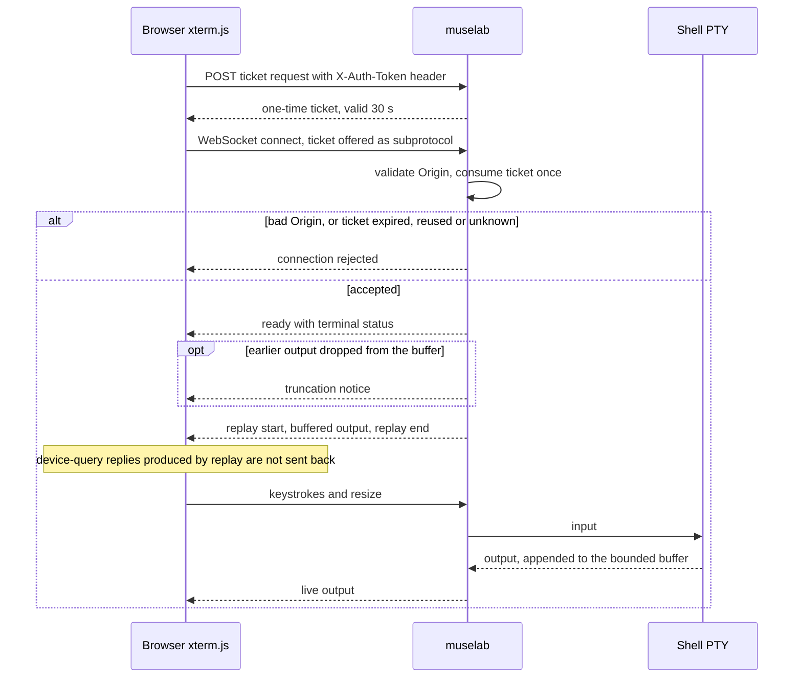
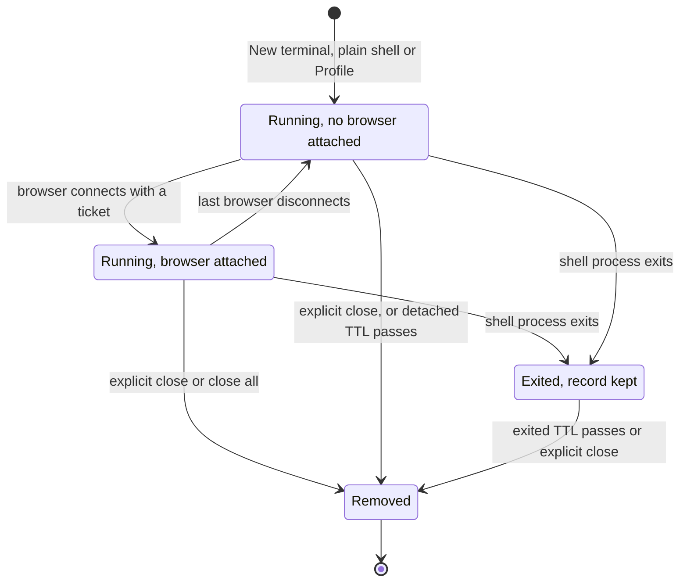

# Terminal

> [简体中文](terminal_zh.md)

muselab provides a real Unix PTY in the preview pane. It is not a command
simulator: input runs with the privileges of the muselab service account in the
selected workspace.

## Entry points

On desktop, click `>_` in the preview header to open the current workspace's
terminal manager. Mobile also exposes the shortcut in the chat header and
switches to Preview automatically.

The manager supports:

- creating, opening, renaming, and closing terminals;
- viewing status, Profile, and working directory;
- closing every terminal in the current workspace;
- switching between terminal and file tabs in Preview.

Each terminal is bound to the workspace where it was created, whose root is the
initial working directory. Switching tabs, pages, or conversations does not
stop the process. Explicitly closing a terminal does.

## Profiles

A Profile is a persistent name plus startup command. When creating a terminal,
choose:

- Plain shell, which starts only the interactive shell; or
- a Profile, whose saved command is entered and executed after shell startup.

Profiles can be created, edited, deleted, and marked as default. The UI remembers
the recent selection and uses the selector's current value when New terminal is
clicked. Deleting a Profile does not affect terminals already running.

Profiles are stored at
`<primary-workspace>/.muselab/terminal_profiles.json` and should be included in
backups. Profile commands are executable configuration: treat them like scripts
and never store secrets in them.

## Connection and recovery

The connection starts in two steps:

1. The browser uses `X-Auth-Token` to request a short-lived one-time ticket.
2. It connects to the terminal WebSocket with that ticket as a subprotocol.

The long-lived token stays out of the WebSocket URL. A ticket lasts 30 seconds,
can be consumed only once, and the server also validates browser Origin.

The server retains a bounded output buffer. Reconnecting browsers replay output
still in the buffer and receive a notice if earlier output was truncated.
Disconnecting the page does not immediately stop the process; the server reaps
it after the detached TTL. During replay, the frontend does not send responses
regenerated by historical terminal device queries to the current process; this
prevents control-sequence fragments such as `0;276;0c`. Exited terminal records
remain until the exited TTL.

Lifecycle of one terminal on the server:

## Input and scrollback

xterm.js loads only when a terminal is first opened.

| Device | Scrollback | Primary interaction |
|---|---:|---|
| Desktop | 10,000 lines | Keyboard, wheel, standard copy/paste shortcuts |
| Mobile | 3,000 lines | One-finger history scroll, accessory keys, lower memory |

Desktop supports platform copy/paste shortcuts and Ctrl+Shift+C /
Ctrl+Shift+V. Mobile provides Copy, Paste, backslash, Ctrl+C, Esc, Tab, and
arrow accessory keys. An explicit vertical touch handler converts gestures to
line scrolling, so the whole preview page does not move with the terminal.

## Configuration

| Environment variable | Default | Meaning |
|---|---:|---|
| `MUSELAB_TERMINAL_ENABLED` | `1` | Enable the terminal |
| `MUSELAB_TERMINAL_SHELL` | auto-detected | Shell executable |
| `MUSELAB_TERMINAL_MAX_SESSIONS` | `8` | Maximum running terminals service-wide |
| `MUSELAB_TERMINAL_BUFFER_BYTES` | `2097152` | Server replay buffer per terminal |
| `MUSELAB_TERMINAL_DETACHED_TTL` | `1800` | Seconds to retain a running detached terminal |
| `MUSELAB_TERMINAL_EXITED_TTL` | `3600` | Seconds to retain an exited terminal record |

See [Configuration](configuration.md) for bounds and the complete reference.

## Security boundary

The terminal can access the files, network, and processes available to the
muselab service account and is generally not confined to the workspace root.
Giving someone `MUSELAB_TOKEN` effectively lets them use that account's shell
through the browser.

Terminal children inherit a small safe environment and not `MUSELAB_TOKEN` or
provider API keys. Files readable by the service account may still contain
sensitive information. Therefore:

- use HTTPS or a trusted private network;
- run muselab as a dedicated low-privilege account;
- do not expose it to untrusted users;
- do not run it as root;
- review Profile commands and backups as carefully as scripts.

See the [Security model](backend-security.md) for the broader boundary.

## Troubleshooting

- No New terminal action: first open the `>_` manager; the action is in the
  header of that secondary window.
- The wrong Profile ran: confirm the selector shows the desired Profile before
  creating; refresh and retry if it remains stale.
- Mobile does not scroll: drag vertically with one finger inside the terminal
  body, not from the accessory-key row.
- Cannot type backslash: use the `\` accessory key.
- Clicks or swipes type fragments such as `2;276;`: reload an old page. These
  are stale mouse-coordinate reports; the current frontend resets them in the
  normal shell buffer.
- Terminal limit reached: close unused running terminals or change
  `MUSELAB_TERMINAL_MAX_SESSIONS` and restart.
