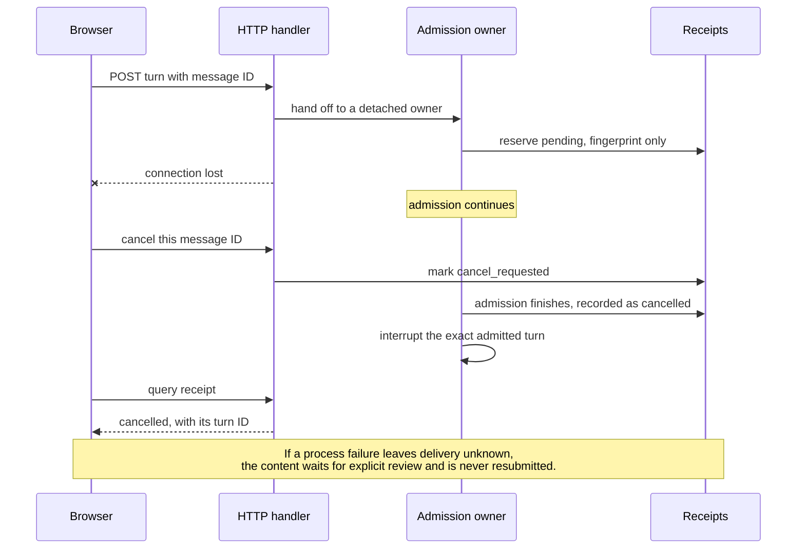
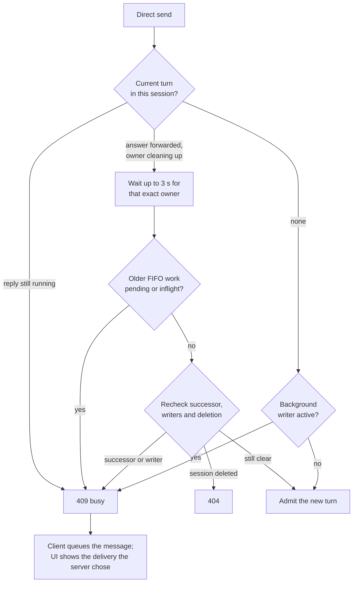

# Conversation and settings reliability

Implementation contract:

- A background task alone does not veto input into an owned foreground turn.
- Delivery feedback reflects the server's actual admission decision.
- Submitted content has a stable identity across admission, queue and history.
- Idle sends paint one inline user bubble immediately; a private pending receipt
  must not appear as a queue card. Only genuinely waiting work uses the outbox.
- Exact queue ownership follows active/mux state so late admission or thumbnail
  responses cannot restore an already-running item to the outbox.
- Stop/cancel targets an exact request or turn; it never cancels a successor.
- Completed history recovers without a page refresh and preserves user scroll.
- Memory content loads independently from configuration and diagnostics.
- Memory sorting applies to all matching rows before pagination.
- File references retain the absolute path of their originating workspace.
- Settings separate daily preferences, memory browsing, maintenance and upgrades.
- Settings loading/error rows remain inside the scroll clip. Timeouts use an
  actionable message; superseded opens cannot overwrite the current result.
- Diagnostic work must not block stream delivery; durable chat data is not dropped.

Regression fixtures must be synthetic and isolated from live sessions, credentials,
memory registries and workspaces. Measure local feedback, server admission, model
latency and final visibility separately. Preserve existing virtualized history and
stable DOM identity protections when changing presentation.

Delivery receipts store a request fingerprint and acknowledgement identifiers,
not prompt text. Reusing an ID cannot execute a second turn. An HTTP disconnect
does not cancel the admission owner. A cancellation during admission remains
pending until its exact turn can be identified. If delivery cannot be established
after a process failure, the UI keeps the content and requires explicit review
before restoring it as a draft; it never automatically resubmits.

Only diagnostic logging and Hook trace persistence use bounded best-effort
workers. Authoritative chat, queue, attachment and receipt commits stay durable.
Context measurements are reused only for the same unchanged SDK generation,
within 20 seconds, below 50 percent including the next prompt estimate, and without
background/scheduled writers. Post-turn control probes have a three-second bound.

A direct send may wait up to three seconds for an exact result-forwarded owner
to release its slot, without presenting internal cleanup as queue activity.
Revalidate successor ownership, background writers, deletion and older FIFO work
after waiting. A still-running reply is not eligible for this cleanup grace.

