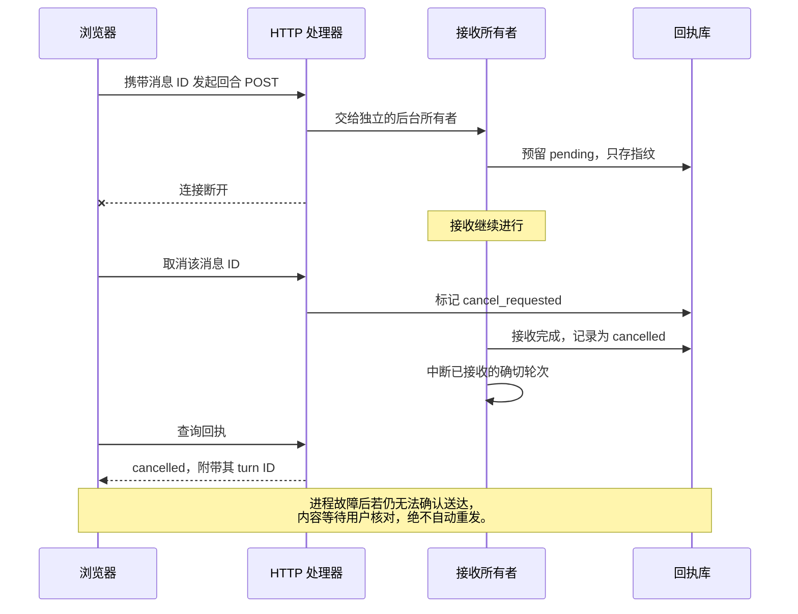
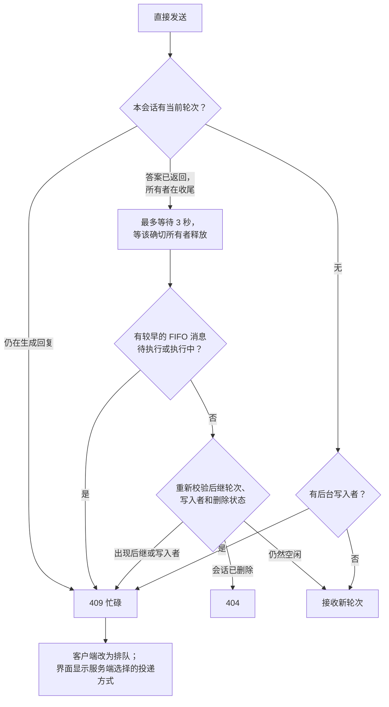

# 会话与设置的可靠性约定

- 后台任务本身不阻止向仍有明确归属的前台轮次插入输入。
- 发送状态以服务端实际接收方式为准，不承诺每次工具结束都能插入。
- 空闲发送立即显示一条普通用户消息及发送中状态；内部回执记录不显示为排队卡片。
- 真正等待执行的消息才进入输入框上方的待发送区；主轮次携带精确队列 ID，晚到的
  接收回包或缩略图请求不能把已开始执行的消息重新放回待发送区。
- 停止绑定具体请求或轮次，不误停后继轮次；停止期间才完成入队的消息也保持暂停。
- 最终历史自动同步，保留用户滚动位置及已有 DOM 身份。
- 记忆内容与配置、诊断独立读取；排序在完整筛选集上执行，再分页。
- 文件引用捕获来源工作区的绝对路径，不随当前工作区切换而变化。
- 设置区分日常配置、记忆浏览、服务维护和版本更新。
- 设置加载与错误提示不能超出滚动裁剪区域；超时提供可读提示和重试，较早打开
  设置产生的请求不能覆盖当前结果。

发送回执仅保存请求指纹和确认标识，不保存提示词。相同请求 ID 不会执行第二轮；
HTTP 断开不取消正在接收请求的后台所有者。接收期间的取消必须等待定位具体轮次，
不能提前显示“从未执行”。进程故障后如果仍不能确认送达，界面保留内容，要求用户
核对历史后再决定是否恢复为草稿，不自动重发。

只有诊断日志与 Hook 轨迹使用有界、允许丢弃诊断数据的工作线程；聊天、队列、
附件和发送回执仍采用可靠写入。上下文测量仅在同一 SDK 状态代次未改变、20 秒内、
计入下条输入后仍低于窗口的 50％、且没有后台或定时写入者时复用。收尾控制探测
最多等待 3 秒。

答案已返回但原轮次仍在收尾时，直接发送可等待该确切所有者释放，最多 3 秒，
不把内部释放间隙立刻显示成排队。等待后重新校验后继轮次、后台写入、删除状态
和较早接收的 FIFO 消息；仍在生成回复的轮次不适用此收尾等待。

回归测试必须使用合成会话、临时工作区及测试凭据，分别验证本地反馈、接收、
模型响应和最终可见性。改动展示层时保留现有的长历史虚拟化和稳定 DOM 身份保护。
